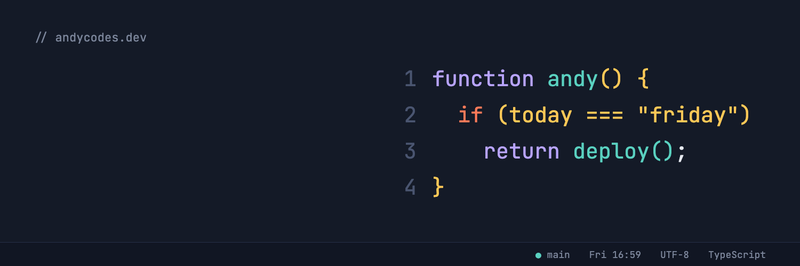

<p align="center">
  
</p>

<h1 align="center">andycodes.dev</h1>

<p align="center">
  The personal site of <a href="https://github.com/andycodesbugs">andycodes</a>.<br />
  <a href="https://andycodes.dev"><b>andycodes.dev</b></a> ·
  <a href="https://x.com/andycodesbugs">@andycodesbugs</a>
</p>

<p align="center">
  <a href="https://github.com/andycodesbugs/andycodes.dev/actions/workflows/deploy.yml"></a>
  
  
  
</p>

---

## ▶ Run it

```sh
npm install
npm run dev      # http://localhost:4321
npm run build    # static output in dist/
```

## 🗂 Where things live

| Path | What's in it |
|---|---|
| `src/data/site.ts` | All the content: hero line, bio, stack, projects, links |
| `src/pages/index.astro` | The page itself: hero, `projects.rs`, `about.md`, `contact.sh` |
| `src/pages/404.astro` | The 404 page, which fails like a Rust compiler |
| `src/components/EasterEggs.astro` | Things you weren't supposed to find (see below) |
| `src/components/Logo.astro` | The logo |
| `brand/` | Avatar and X banner. Not shipped with the site |

## 🥚 Easter eggs

<details>
<summary>Spoilers. Try finding them on the site first.</summary>

<br />

- **Terminal:** press <kbd>`</kbd>, like in VS Code, or tap `>_` in the status bar. Try `help`, `ls -a`, `cargo run`, `sudo`, `coffee` and `vim`.
- **Konami code:** <kbd>↑</kbd> <kbd>↑</kbd> <kbd>↓</kbd> <kbd>↓</kbd> <kbd>←</kbd> <kbd>→</kbd> <kbd>←</kbd> <kbd>→</kbd> <kbd>B</kbd> <kbd>A</kbd>.
- **DevTools:** open the console and say hi to `andy.help()`.
- **Status bar:** the `Ln, Col` counter follows your mouse.
- **404:** visit any page that doesn't exist.

</details>

## 🚀 Deploying

Every push to `main` builds the site and publishes it to GitHub Pages (`.github/workflows/deploy.yml`). The custom domain comes from `public/CNAME`, and DNS sits on Cloudflare.

---

<p align="center"><sub>Made with ☕ and questionable Friday deploys.</sub></p>
